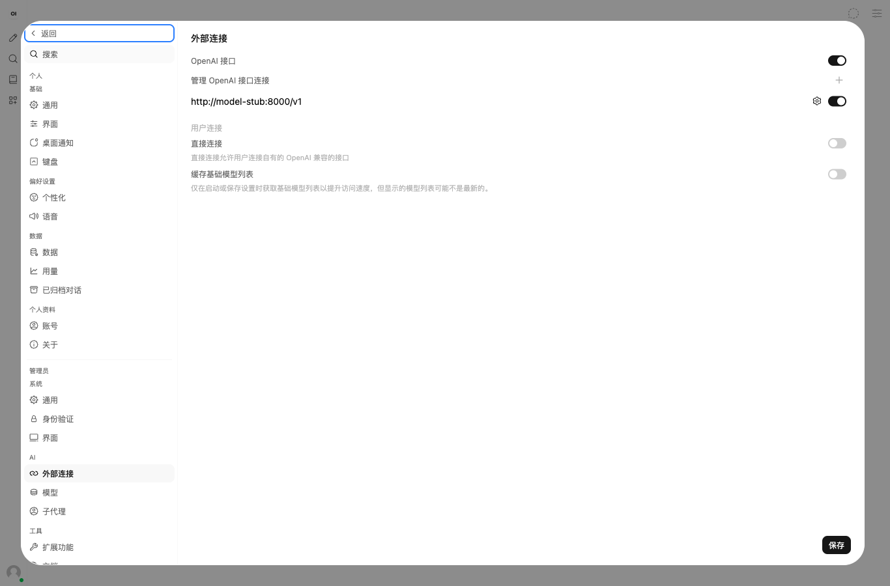
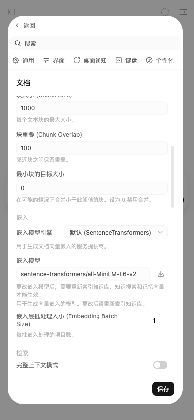
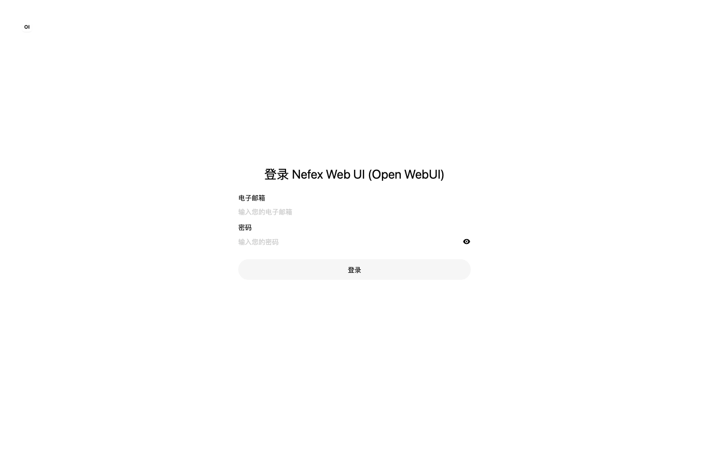
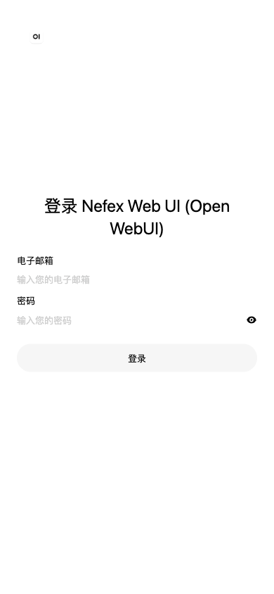

# Docker 安装与接入移除验证记录

各个正式版本的镜像摘要、构建任务与实际功能验证范围见对应 GitHub Release 中的 `images.json` 和 `verification.json`。下文为最初部署改造的历史记录。v0.12.7 的更新器回归覆盖旧项目名、配置保留、镜像拉取失败、更新失败恢复、备份校验、匿名卷和独立下载入口；Linux/macOS 安装器 CI 与镜像内后端测试在发布前分别执行。真实旧版更新和恢复演练的结果随该版本的验证文件发布。

验证日期：2026-10-17（Asia/Shanghai）。

## 结果

Ollama 原生聊天、嵌入、云搜索、连接和模型管理入口已移除。完整 Docker 镜像构建成功，应用、PostgreSQL / pgvector、MinIO、Redis、SearXNG 均通过真实服务检查。一次性建桶任务成功退出，重复执行也成功。

本机保留的安装位于 <http://localhost:3180>，绑定 `127.0.0.1`，等待首次创建管理员。默认模板使用 3000；本机原有项目占用该端口，因此本次安装使用 3180。

## 环境

- macOS Docker Desktop，Linux arm64；Docker 29.8.2、Compose 5.5.1。
- 首轮从源码完整构建的应用镜像约 7.25 GB；当时应用镜像摘要 `sha256:2475735071b76b8712ee5846b2feae6ad2fd49c6c21d02f27192ea2707c8feeb`。
- PostgreSQL 17.11 / pgvector 0.8.7、Redis 7.4.11、SearXNG 2026.10.16、MinIO `RELEASE.2025-10-15T17-29-55Z` 源码构建。
- 独立验证项目 `olm-smoke` 使用 3100，模型调用通过临时 OpenAI 兼容测试服务；正式安装没有保存测试管理员或测试模型连接。
- Browser 插件未安装，按 `frontend-testing-debugging` 技能使用 Playwright；界面验证浏览器 Chromium 155.0.8059.80，桌面 1366×900、移动端 390×844。

## 自动回归

| 检查                                                                                         | 结果     |
| -------------------------------------------------------------------------------------------- | -------- |
| 安装器测试：独立随机密钥、权限、重复执行、既有配置保留、自定义环境路径、启动失败、只检查模式 | 6 项通过 |
| 后端：聊天工具与多模态消息、SSE 和清理、批量嵌入、函数模型、旧配置幂等升级、拒绝退役引擎     | 6 项通过 |
| 现有前端单元测试                                                                             | 4 项通过 |
| Python F 类逻辑检查、编译、Shell 语法、Compose 配置、补丁空白检查                            | 通过     |
| 生产前端和完整应用 / MinIO 镜像构建                                                          | 通过     |

全局 `svelte-check` 未全绿：修改前基线为 5696 个错误，修改后为 5608 个错误；按文件和错误信息去除路径差异后，没有新增错误类型。现有类型问题不在本次移除接入和部署改造的修复范围内。

## 真实服务与应用链路

| 流程                  | 结果与证据                                                                                    |
| --------------------- | --------------------------------------------------------------------------------------------- |
| 应用 / 数据库         | `/health`、`/health/db` 均返回 `{"status":true}`                                              |
| PostgreSQL / pgvector | 真实建立临时向量表并执行余弦距离检索，预期最近项距离为 0                                      |
| MinIO                 | 初始化存储桶连续执行两次；真实上传、下载比对、删除通过                                        |
| Redis                 | 带认证读写和发布 / 订阅通过                                                                   |
| SearXNG               | JSON API 返回有效上游结果；默认源经实测调整为 startpage、yahoo、sogou、bing                   |
| Chromium              | 完整镜像内浏览器启动通过                                                                      |
| 管理员 / 配置         | 独立验证库注册、登录、功能配置与文档设置读取通过                                              |
| 模型接口              | 测试提供商的模型发现、非流式聊天、流式聊天和两项批量嵌入通过                                  |
| 退役接口              | 原生聊天 POST 返回 405；嵌入设置不再包含旧配置，旧引擎输入返回 422                            |
| 文件 / RAG            | 经应用上传和读取 S3 文件、本地模型编码、PostgreSQL 向量存储、文档查询命中、文件删除后返回 404 |
| 笔记 / 频道           | 创建成功并返回已保存记录；频道名称按既有规则转为小写                                          |
| 应用联网搜索          | 由应用调用 SearXNG，Chromium 加载真实网页并生成向量集合，实测载入 3 页并生成 1 个向量集合     |
| 本地模型离线          | 容器禁用网络，镜像内嵌入模型成功输出 384 维向量                                               |
| 浏览器代码执行        | 阻止浏览器外部 HTTPS 请求后，本地 Pyodide 314.0.3 加载 NumPy，`np.arange(5).sum()` 得到 10    |

## 界面检查

验证路径：登录 → 管理员外部连接 → 添加连接并验证 → 文档嵌入设置 → 移动端查看。

| 检查           | 结果                                                                      |
| -------------- | ------------------------------------------------------------------------- |
| 页面身份       | 首轮标题 Open WebUI；管理员设置路由打开首页上的设置弹窗，符合现有路由行为 |
| 非空白         | 聊天、连接和文档内容正常显示                                              |
| 框架错误覆盖层 | 无                                                                        |
| 控制台         | 无应用错误；存在既有 manifest enctype 提示，不阻断本次流程                |
| 交互           | OpenAI 兼容连接验证返回 200，并显示“已验证服务器连接”                     |
| 移除入口       | 连接与文档设置均无 Ollama 控件；嵌入选项为本地、OpenAI、Azure OpenAI      |
| 移动端         | 390×844 无页面横向溢出，文档字段与保存按钮可见                            |

## 主要命令

```bash
./scripts/install-docker.sh --init-only
./scripts/install-docker.sh
./scripts/install-docker.sh --no-build
./scripts/install-docker.sh --check
python3 -m unittest discover -s scripts/tests -v
python -m unittest discover -s tests -p test_provider_dispatch.py -v
npm run test:frontend -- --run
npm run check
```

后端测试在完整镜像内运行；应用接口和界面测试在独立验证项目中运行。临时验证容器、卷和凭据在验证后清理，保留正式安装。

## 验证边界

正式模型推理、图片生成 / 编辑、OAuth、云盘及外部工具服务器需要对应服务和凭据，本次没有调用真实付费模型或供应商账号。CUDA 与 amd64 未在本机实际运行。旧 SQLite、本地上传和旧向量数据不会由安装器自动迁移，迁移步骤见 [安装说明](docker-install.md)。

## 截图

桌面外部连接页面和移动端文档嵌入页面：




## Nefex 镜像发布验证

本次更名后默认使用官方完整运行环境，依赖文件 SHA-256 与源码一致：`d532d221dcd8beb0d36f7756259cc33515464c060775f5de3c8b197a5f55f098`。默认构建会校验该文件，避免依赖变化后误用旧运行环境。CPU 基础镜像固定为 `ghcr.io/open-webui/open-webui:v0.12.3@sha256:a537bbe1e6b428820f52ed4a029d7fff97062e24d5cf32c365fba36fd0542def`；CUDA 使用同版本官方 CUDA 镜像。

安装器默认拉取成品镜像，源码构建改为 `--build`，已有镜像的离线启动使用 `--no-build`。新增的回归测试覆盖三种模式，目前安装器共 7 项测试通过；既有前端 4 项测试通过。界面保留 Open WebUI 标识，项目与默认部署名改为 Nefex Web UI。原有运行实例保留 Compose 项目名和所有数据卷。

发布 ARM64 镜像已通过匿名拉取，摘要为 `sha256:cc3ab7f085000d6a29b24c18145e6ec0cadc243f6a62d3f249915d7e80a46fa5`，OCI revision 为 `08cc09c83be2e53142576307ccd7cfb20ba70e3d`。隔离项目 `nefex-smoke` 直接使用该发布产物，应用、数据库、向量查询、S3、Redis、搜索和 Chromium 六项安装检查全部通过。应用 API 回归验证了注册登录、Nefex 名称、功能设置、模型发现、普通/流式聊天、批量嵌入、退役接口、文件上传/下载/删除、本地嵌入与 RAG、笔记和频道；模型调用使用临时测试提供商。

应用联网搜索实际载入 4 个网页并生成 1 个向量集合。浏览器屏蔽外部 HTTPS 请求后，镜像继承的 Pyodide 314.0.3 成功加载 NumPy，计算结果为 10。新名称在登录页和浏览器标题中可见；桌面 1366×900 与移动端 390×844 检查通过，无横向溢出，无应用控制台错误，仍有既有 manifest 警告。

更名后的登录页面：




本机正式实例已用发布的 ARM64 应用和 MinIO 镜像升级，继续使用 `olm` 项目名与原有五个数据卷，入口仍为 <http://localhost:3180>。MinIO ARM64 发布摘要为 `sha256:77c03d023496f2c3732c56a77054ca43d363817ce922b6c218082d8025b88698`。两个发布镜像均已在空 Docker 配置下匿名拉取成功；安装器实际执行默认拉取路径，六项检查全部通过，五个服务均健康，建桶任务退出码为 0。公共配置返回 `Nefex Web UI (Open WebUI)`，`onboarding=true`，没有保留验证管理员。

缓存改进不改变应用镜像内容：后续 CPU 缓存导出限时且不阻断发布，CUDA 直接复用官方镜像层，不导出大体积运行环境缓存。此配置已通过 actionlint 检查。

最终[构建与发布流水线](https://github.com/Albert-Li-Sz/Nefex-Web-UI/actions/runs/38963261558)成功完成，应用源代码 revision 为 `08cc09c83be2e53142576307ccd7cfb20ba70e3d`。amd64、arm64 CPU 和 amd64 CUDA 镜像均在原生运行器通过 6 项后端回归测试；CUDA 检查在无 NVIDIA GPU 的运行器上使用 CPU 回退，不代表实际 GPU 加速验收。安装器 7 项、后端 6 项、前端 4 项，共 17 项不同回归测试通过。

| 发布镜像                                                               | 多架构索引摘要                                                            | 平台                     |
| ---------------------------------------------------------------------- | ------------------------------------------------------------------------- | ------------------------ |
| `ghcr.io/albert-li-sz/nefex-web-ui:latest`                             | `sha256:c626bff1ddbd458a86633a784e70dee8b2482aeb391ae264307f0d7917e46891` | linux/amd64, linux/arm64 |
| `ghcr.io/albert-li-sz/nefex-web-ui:cuda`                               | `sha256:150e6968321f30c18646e0b0ad56b2f260509526ec599dc56c04259df912910e` | linux/amd64              |
| `ghcr.io/albert-li-sz/nefex-web-ui-minio:RELEASE.2025-10-15T17-29-55Z` | `sha256:1341d0b11608f7565e5a98d287d43329e2058b94956e1fc3355160f006be6ab9` | linux/amd64, linux/arm64 |

最终又以不带镜像覆盖参数的默认命令 `./scripts/install-docker.sh` 完成一次真实安装验收：默认发布标签匿名拉取成功，运行容器的镜像标识与最终发布标签一致，五个服务健康且六项安装检查全部通过。应用代码自构建 revision 后未再变更，后续提交仅更新验证文档、截图与缓存导出策略，因此不重复构建应用镜像。
